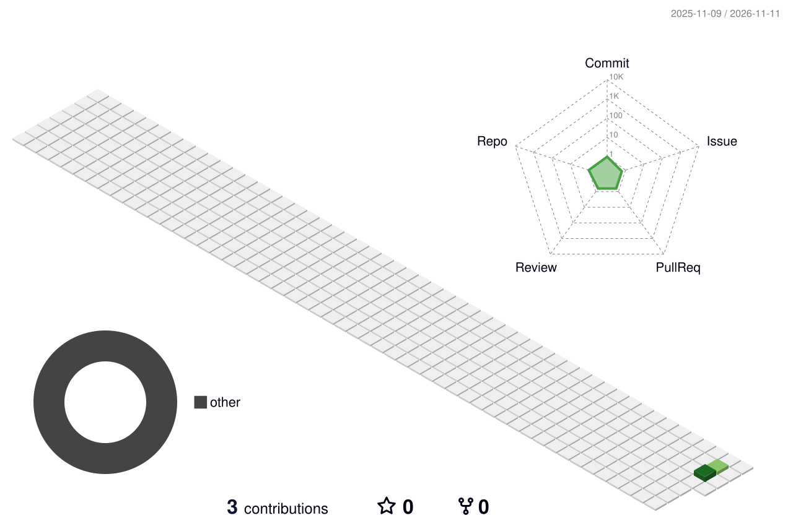

<!-- ═══════════════════════════ HERO ═══════════════════════════ -->
<div align="center">


<a href="https://ashley.lyncxs.com">
  
</a>

<br/>


<br/><br/>

<a href="https://ashley.lyncxs.com"></a>
<a href="https://linkedin.com/company/lyncxs-ai"></a>
<a href="mailto:lyncxsindustries@gmail.com"></a>
<a href="https://huggingface.co/lyncxsai"></a>

</div>


<!-- ═══════════════════════════ ABOUT AI ═══════════════════════════ -->
<h2 align="center">🧠 ABOUT ASHLEY AI</h2>

<table align="center">
<tr>
<td width="55%" valign="top">

```json
{
  "name": "Ashley AI",
  "mission": "African-first multilingual AI assistant",
  "organization": "Lyncxs Industries",
  "location": "Kenya 🇰🇪 · East Africa 🌍",
  "languages": {
    "supported": ["Swahili", "Kikuyu", "Luo", "Sheng", "English"],
    "in_training": ["Kikamba", "Dholuo", "Somali"]
  },
  "capabilities": [
    "Cultural context understanding",
    "Offline-first architecture",
    "Voice synthesis & recognition",
    "M-Pesa integration",
    "African market knowledge"
  ],
  "approach": "Privacy-preserving · Edge AI · Ubuntu philosophy",
  "philosophy": "AI that understands 'we' before 'me'"
}
```

</td>
<td width="45%" align="center" valign="middle">


</td>
</tr>
</table>

<!-- ═══════════════════════════ WHAT WE'RE BUILDING ═══════════════════════════ -->
<h2 align="center">🌱 WHAT WE'RE BUILDING</h2>

<div align="center">

| | Project | What it is | Status |
|:-:|:--|:--|:--|
| 💚 | **Ashley AI Core** | Multilingual conversational AI with African language understanding and cultural context engine. | Alpha |
| 🗣️ | **Voice Synthesis** | High-quality voice generation for Swahili, Kikuyu, and other African languages. | Research |
| 📚 | **African Datasets** | Open-source language datasets: Swahili corpus, Sheng dictionary, cultural knowledge graph. | Active |
| 🌐 | **Offline Models** | Edge-optimized AI models that run without internet (critical for African connectivity). | Beta |
| 🔗 | **M-Pesa Integration** | Native payment and financial assistance for the M-Pesa ecosystem. | Planning |

</div>

<!-- ═══════════════════════════ TECH STACK ═══════════════════════════ -->
<h2 align="center">🛠️ TECH STACK</h2>

<div align="center">


<br/>

<br/>

<br/>


</div>

<!-- ═══════════════════════════ GITHUB STATS ═══════════════════════════ -->
<h2 align="center">📊 GITHUB STATS</h2>

<div align="center">


</div>

<!-- ═══════════════════════════ CONTRIBUTION GRAPH ═══════════════════════════ -->
<h2 align="center">📈 CONTRIBUTION GRAPH</h2>

<div align="center">


</div>

<!-- ═══════════════════════════ TROPHIES ═══════════════════════════ -->
<h2 align="center">🏆 GITHUB TROPHIES</h2>

<div align="center">


</div>

<!-- ═══════════════════════════ 3D CONTRIBUTIONS ═══════════════════════════ -->
<h2 align="center">🗓️ 3D CONTRIBUTION CALENDAR</h2>

<div align="center">



</div>

<!-- ═══════════════════════════ CONNECT ═══════════════════════════ -->
<h2 align="center">🤝 COLLABORATE WITH US</h2>

<div align="center">
  <i>Open to partnerships, research collaborations, and dataset contributions.</i>
  <br/><br/>
  <a href="mailto:lyncxsindustries@gmail.com"></a>
  <a href="https://huggingface.co/lyncxsai"></a>
</div>


