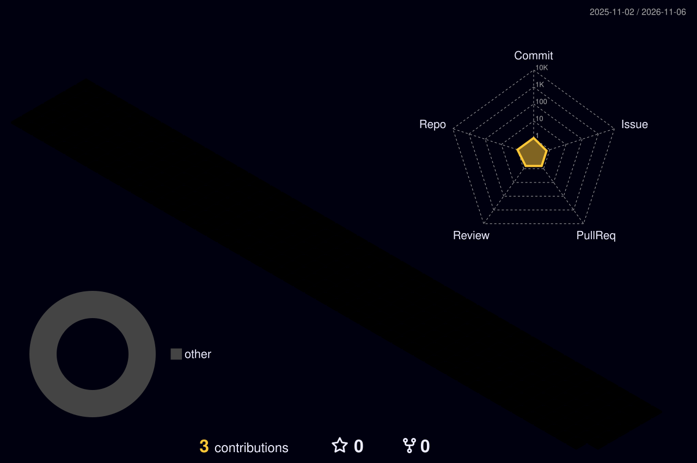

<!-- FILE: .github/profile/README.md | ORG HANDLE: LyncxsAI -->

<!-- ═══════════════════════════════════════════════════════
     HEADER
═══════════════════════════════════════════════════════ -->
<div align="center">


<br/><br/>

<a href="https://git.io/typing-svg">
  
</a>

<br/><br/>

<!-- ═══════════════════════════════════════════════════════
     BADGES
═══════════════════════════════════════════════════════ -->

[](https://lyncxs.com)
[](https://linkedin.com/company/lyncxsai)
[](https://twitter.com/lyncxsai)
[](mailto:ai@lyncxs.com)

</div>

<!-- ═══════════════════════════════════════════════════════
     ABOUT
═══════════════════════════════════════════════════════ -->


### <svg width="32" height="32" viewBox="0 0 24 24" fill="none" xmlns="http://www.w3.org/2000/svg"><circle cx="12" cy="12" r="3" fill="#10B981"/><path d="M12 2v4M12 18v4M4.93 4.93l2.83 2.83M16.24 16.24l2.83 2.83M2 12h4M18 12h4M4.93 19.07l2.83-2.83M16.24 7.76l2.83-2.83" stroke="#14B8A6" stroke-width="2" stroke-linecap="round"/></svg> About Lyncxs AI

```python
class LyncxsAI:
    def __init__(self):
        self.mission = "Building AI systems for African contexts"
        self.location = "Kenya"
        self.focus = [
            "Multilingual AI assistants",
            "African language models",
            "Context-aware intelligence",
            "Ethical AI development"
        ]
        
    @property
    def products(self):
        return {
            "ashley": {
                "type": "AI Assistant",
                "languages": ["English", "Swahili", "Sheng", "more"],
                "features": ["NLP", "Context understanding", "Cultural awareness"]
            },
            "baseline": {
                "type": "AI Framework",
                "purpose": "Rapid AI development",
                "features": ["MCP integration", "Skills system", "Agent framework"]
            }
        }
        
    def impact(self):
        return "Democratizing AI for African users"
```

<br clear="right"/>

<!-- ═══════════════════════════════════════════════════════
     TECH STACK
═══════════════════════════════════════════════════════ -->

---

### <svg width="32" height="32" viewBox="0 0 24 24" fill="none" xmlns="http://www.w3.org/2000/svg"><path d="M12 2L2 7l10 5 10-5-10-5z" fill="#10B981"/><path d="M2 17l10 5 10-5" fill="#14B8A6"/><path d="M2 12l10 5 10-5" fill="#22C55E"/></svg> AI & ML Stack

<div align="center">

#### AI/ML Frameworks


#### LLM & APIs


#### Data & Vector DBs


</div>

<!-- ═══════════════════════════════════════════════════════
     STATISTICS
═══════════════════════════════════════════════════════ -->

---

### <svg width="32" height="32" viewBox="0 0 24 24" fill="none" xmlns="http://www.w3.org/2000/svg"><path d="M3 13h2v8H3zM7 9h2v12H7zM11 5h2v16h-2zM15 9h2v12h-2zM19 2h2v20h-2z" fill="#10B981"/></svg> Research & Development Metrics

<div align="center">


  
<table>
<tr>
<td width="50%">


</td>
<td width="50%">


</td>
</tr>
</table>

<br clear="right"/>


<br/>


</div>

<!-- ═══════════════════════════════════════════════════════
     TROPHIES
═══════════════════════════════════════════════════════ -->

---

### <svg width="32" height="32" viewBox="0 0 24 24" fill="none" xmlns="http://www.w3.org/2000/svg"><path d="M19 5h-2V3H7v2H5c-1.1 0-2 .9-2 2v1c0 2.55 1.92 4.63 4.39 4.94.63 1.5 1.98 2.63 3.61 2.96V19H7v2h10v-2h-4v-3.1c1.63-.33 2.98-1.46 3.61-2.96C19.08 12.63 21 10.55 21 8V7c0-1.1-.9-2-2-2zM5 8V7h2v3.82C5.84 10.4 5 9.3 5 8zm14 0c0 1.3-.84 2.4-2 2.82V7h2v1z" fill="#22C55E"/></svg> AI Achievements

<div align="center">


  
  
<br clear="right"/>
  
</div>

<!-- ═══════════════════════════════════════════════════════
     ACTIVITY GRAPH
═══════════════════════════════════════════════════════ -->

---

### <svg width="32" height="32" viewBox="0 0 24 24" fill="none" xmlns="http://www.w3.org/2000/svg"><path d="M3 3l18 9-18 9V3z" fill="#10B981"/><circle cx="21" cy="12" r="2" fill="#14B8A6"/></svg> Model Training & Development

<div align="center">
  
[](https://github.com/LyncxsAI)

</div>

<!-- ═══════════════════════════════════════════════════════
     SNAKE ANIMATION
═══════════════════════════════════════════════════════ -->

---

### <svg width="32" height="32" viewBox="0 0 24 24" fill="none" xmlns="http://www.w3.org/2000/svg"><path d="M3 3h3v3H3zM9 3h3v3H9zM15 3h3v3h-3zM3 9h3v3H3zM9 9h3v3H9zM15 9h3v3h-3z" fill="#10B981"/><path d="M3 15h3v3H3zM9 15h3v3H9z" fill="#14B8A6"/></svg> Training Progress

<div align="center">

<picture>
  <source media="(prefers-color-scheme: dark)" srcset="https://raw.githubusercontent.com/LyncxsAI/LyncxsAI/output/github-contribution-grid-snake-dark.svg">
  <source media="(prefers-color-scheme: light)" srcset="https://raw.githubusercontent.com/LyncxsAI/LyncxsAI/output/github-contribution-grid-snake.svg">
  
</picture>

</div>

<!-- ═══════════════════════════════════════════════════════
     3D CONTRIBUTION
═══════════════════════════════════════════════════════ -->

---

### <svg width="32" height="32" viewBox="0 0 24 24" fill="none" xmlns="http://www.w3.org/2000/svg"><circle cx="5" cy="12" r="3" fill="#10B981"/><circle cx="12" cy="12" r="3" fill="#14B8A6"/><circle cx="19" cy="12" r="3" fill="#22C55E"/><path d="M5 12h14" stroke="#4ADE80" stroke-width="2"/></svg> 3D Model Performance

<div align="center">


  
  
<br clear="right"/>
  
</div>

<!-- ═══════════════════════════════════════════════════════
     AI PRODUCTS
═══════════════════════════════════════════════════════ -->

---

### <svg width="32" height="32" viewBox="0 0 24 24" fill="none" xmlns="http://www.w3.org/2000/svg"><path d="M12 2L2 7l10 5 10-5-10-5zM2 17l10 5 10-5M2 12l10 5 10-5" stroke="#10B981" stroke-width="2"/></svg> AI Products & Research

<table align="center">
<tr>
<td align="center" width="50%">

#### <svg width="24" height="24" viewBox="0 0 24 24" fill="none" xmlns="http://www.w3.org/2000/svg"><circle cx="12" cy="8" r="3" fill="#10B981"/><path d="M12 14c-4 0-8 2-8 4v2h16v-2c0-2-4-4-8-4z" fill="#10B981"/></svg> Ashley AI
Multilingual AI assistant with deep African context understanding

**Features:**
- Natural language processing in 10+ African languages
- Cultural context awareness
- Voice and text interaction
- Offline capabilities

</td>
<td align="center" width="50%">

#### <svg width="24" height="24" viewBox="0 0 24 24" fill="none" xmlns="http://www.w3.org/2000/svg"><rect x="3" y="3" width="18" height="18" rx="2" fill="none" stroke="#14B8A6" stroke-width="2"/><circle cx="8" cy="8" r="2" fill="#14B8A6"/><circle cx="16" cy="8" r="2" fill="#14B8A6"/><circle cx="12" cy="16" r="2" fill="#14B8A6"/></svg> Baseline Framework
Open-source AI development framework for rapid prototyping

**Features:**
- MCP protocol integration
- Modular skills system
- Agent orchestration
- Public & private modes

</td>
</tr>
</table>

<!-- ═══════════════════════════════════════════════════════
     CORE VALUES
═══════════════════════════════════════════════════════ -->

---

### <svg width="32" height="32" viewBox="0 0 24 24" fill="none" xmlns="http://www.w3.org/2000/svg"><path d="M12 2l2.4 7.4h7.6l-6 4.6 2.3 7-6.3-4.6-6.3 4.6 2.3-7-6-4.6h7.6L12 2z" fill="#22C55E"/></svg> AI Ethics & Principles

<table align="center">
<tr>
<td align="center" width="33%">

#### <svg width="24" height="24" viewBox="0 0 24 24" fill="none" xmlns="http://www.w3.org/2000/svg"><circle cx="12" cy="12" r="10" fill="none" stroke="#10B981" stroke-width="2"/><path d="M12 6v6l4 2" stroke="#10B981" stroke-width="2"/></svg> Ethical AI
Responsible AI development with human rights at the core

</td>
<td align="center" width="33%">

#### <svg width="24" height="24" viewBox="0 0 24 24" fill="none" xmlns="http://www.w3.org/2000/svg"><circle cx="12" cy="12" r="10" fill="none" stroke="#14B8A6" stroke-width="2"/><path d="M12 2v20M2 12h20" stroke="#14B8A6" stroke-width="2"/></svg> Inclusive
AI systems that work for all African users

</td>
<td align="center" width="33%">

#### <svg width="24" height="24" viewBox="0 0 24 24" fill="none" xmlns="http://www.w3.org/2000/svg"><path d="M12 2L2 7v10c0 5.55 3.84 10.74 9 12 5.16-1.26 9-6.45 9-12V7l-10-5z" fill="#22C55E"/></svg> Privacy First
User data protection and transparency

</td>
</tr>
</table>

<!-- ═══════════════════════════════════════════════════════
     CONNECT
═══════════════════════════════════════════════════════ -->

---

### <svg width="32" height="32" viewBox="0 0 24 24" fill="none" xmlns="http://www.w3.org/2000/svg"><path d="M20 2H4c-1.1 0-2 .9-2 2v18l4-4h14c1.1 0 2-.9 2-2V4c0-1.1-.9-2-2-2z" fill="#10B981"/></svg> Connect & Collaborate

<div align="center">

[](https://github.com/LyncxsAI)
[](https://linkedin.com/company/lyncxsai)
[](https://twitter.com/lyncxsai)
[](https://lyncxs.com)
[](mailto:ai@lyncxs.com)

</div>

---

<div align="center">

### <svg width="24" height="24" viewBox="0 0 24 24" fill="none" xmlns="http://www.w3.org/2000/svg"><path d="M9 2L7 12h4l-2 10 10-14h-5l2-6z" fill="#22C55E"/></svg> "Intelligent Systems. African Context. Global Impact."


</div>

<!-- ═══════════════════════════════════════════════════════
     FOOTER
═══════════════════════════════════════════════════════ -->


